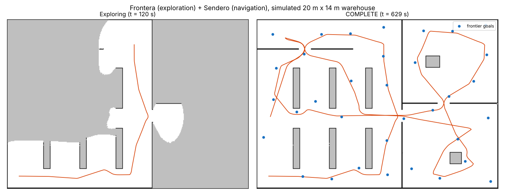
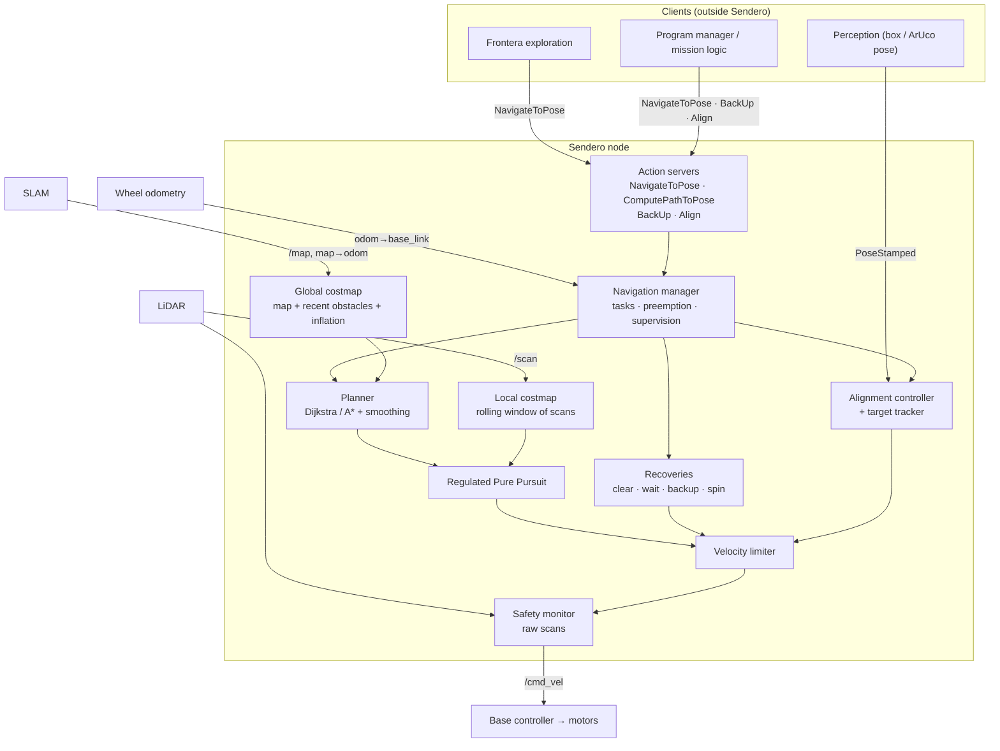

# Sendero

**Supervised, Nav2-compatible navigation for ROS 2.**

Sendero takes a mobile robot to a goal on a map that may still be growing.
It plans a path, follows it, avoids what its sensors see, recovers when it
gets stuck, and reports the result. It also aligns the robot precisely
with a target that perception sees, for docking or forklift work.

Sendero is a single ROS 2 node. Any `NavigateToPose` client works with it
unchanged, including the [Frontera](https://github.com/raymundo140/frontera-ros2)
exploration framework, RViz's goal tool and Nav2 clients. It needs only four
standard inputs:

1. a `nav_msgs/OccupancyGrid` map (from any SLAM system or a map server),
2. TF: `map -> odom -> base_link -> laser`,
3. one or more `sensor_msgs/LaserScan` topics,
4. a base controller that executes `geometry_msgs/Twist`.



## Mechanisms

| Mechanism | What it does |
|---|---|
| Layered costmaps | A global costmap holds the SLAM map plus obstacles the sensors saw recently. A rolling local costmap holds recent scans. Both are inflated with Nav2 cost semantics, and recent obstacles expire so moving objects leave no trace. |
| Cost-aware planning | A grid search keeps paths away from walls where there is room and still uses narrow gaps. Unknown space is plannable only while exploring. A blocked start or goal moves to the nearest free cell. Smoothing never cuts closer to walls than the search did. |
| Regulated Pure Pursuit | The path follower of Nav2. It slows on tight curves, near obstacles and on the final approach. It projects every command forward against the local costmap and checks the path ahead, so the robot replans before it reaches a new obstacle. It supports differential and omnidirectional bases. |
| Navigation profiles | Named sets of footprint, speed, inflation, unknown-space and tolerance settings (for example *exploration*, *transport*, *carrying*). A goal selects one through the standard `behavior_tree` field, so the action definition does not change. |
| Bounded recovery | Blocked paths are waited out while replanning. If the robot stays blocked or makes no progress, a short fixed set of recoveries runs (clear, wait, backup, spin), and then the goal is aborted. Places where the robot was blocked are avoided for a while. Deciding whether a goal is still worth pursuing is left to the client. |
| Independent safety monitor | Every command is checked against the newest raw scan points, not the costmap. It is slowed or stopped before contact, and stopped if the sensor goes silent. Planning or costmap faults upstream cannot override it. |
| Precision alignment | A separate action moves the robot to an exact pose relative to a target that perception tracks. A polar pose controller reaches a pre-pose, then a straight docking approach and a final heading correction follow. The target is filtered, and alignment holds still while it is out of view. |

All navigation logic is plain Python with no ROS dependency
(`sendero/sendero/*.py`). The node (`navigator_node.py`) only connects it
to ROS. NumPy is required. SciPy is optional and makes planning much faster
on large maps.

## Repository layout

```
sendero-ros2/
├── sendero/          ament_python package: the framework and the node
│   ├── config/       sendero.yaml (every parameter, documented), examples
│   ├── launch/       sendero.launch.py
│   ├── sendero/      the modules (see sendero/__init__.py for the map)
│   └── test/         unit tests, closed-loop simulation tests
└── sendero_msgs/     ament_cmake package: the Align action
```

## Requirements

- ROS 2 Humble or Jazzy (the result messages of both are handled)
- `nav2_msgs` (only the message package, not Nav2):
  `sudo apt install ros-$ROS_DISTRO-nav2-msgs`
- Python 3 with NumPy; SciPy recommended

## Installation

```bash
cd ~/ros2_ws/src
git clone https://github.com/raymundo140/sendero-ros2.git
cd ~/ros2_ws
rosdep install --from-paths src --ignore-src -y
colcon build --packages-select sendero_msgs sendero
source install/setup.bash
```

## Usage

Start the robot (or the simulator), SLAM and TF first, then:

```bash
ros2 launch sendero sendero.launch.py params_file:=/path/to/your.yaml
# in simulation, add: use_sim_time:=true
```

Send a goal from RViz with the *2D Goal Pose* tool (Sendero listens on
`/goal_pose`), or through the action from the command line:

```bash
ros2 action send_goal /navigate_to_pose nav2_msgs/action/NavigateToPose \
  "{pose: {header: {frame_id: map}, pose: {position: {x: 3.0, y: 1.0}, orientation: {w: 1.0}}}, behavior_tree: 'transport'}" \
  --feedback
```

Watch it:

```bash
ros2 topic echo /navigation/status
ros2 topic echo /navigation/events
```

In RViz, add `/navigation/plan` (Path), `/navigation/global_costmap` and
`/navigation/local_costmap` (Map, color scheme *costmap*), and
`/navigation/markers` (MarkerArray).

## Interface

### Actions (served)

| Action | Type | Use |
|---|---|---|
| `/navigate_to_pose` | `nav2_msgs/action/NavigateToPose` | Go to a pose. `behavior_tree` = profile name (empty = default). Feedback: current pose, time, ETA, recoveries, distance remaining. |
| `/compute_path_to_pose` | `nav2_msgs/action/ComputePathToPose` | Plan without moving (reachability checks). `planner_id` = profile. |
| `/backup` | `nav2_msgs/action/BackUp` | Reverse `target.x` metres at `speed`, only into free space (for example, after a pickup). |
| `/align` | `sendero_msgs/action/Align` | Precision alignment to a target: a live `PoseStamped` topic or a fixed pose. |

A new goal preempts the active one (`goal_policy: preempt`, as in Nav2) or
is rejected (`goal_policy: reject`). Results follow the GoalStatus
(SUCCEEDED / ABORTED / CANCELED). On Jazzy, `error_code` and `error_msg`
are filled too, with Nav2's numbering where Nav2 defines one (planner 2xx,
controller 1xx, BackUp 71x, navigator 9xxx).

### Topics

| Topic | Type | Direction | Content |
|---|---|---|---|
| `/map` | `nav_msgs/OccupancyGrid` | in | SLAM map |
| `/scan` (list) | `sensor_msgs/LaserScan` | in | obstacles and safety |
| `/navigation/control` | `std_msgs/String` | in | `PAUSE`, `RESUME`, `CANCEL`, `CLEAR_COSTMAPS` |
| `/goal_pose` | `geometry_msgs/PoseStamped` | in | goal without an action client (RViz *2D Goal Pose*) |
| `/cmd_vel` | `geometry_msgs/Twist` (or `TwistStamped`) | out | velocity command, only while a goal is active |
| `/navigation/status` | `std_msgs/String` | out | one word: `IDLE`, `PLANNING`, `FOLLOWING`, `BLOCKED`, `RECOVERING_*`, `ALIGNING_*`, `PAUSED`, ... |
| `/navigation/stats` | `std_msgs/String` | out | key=value statistics (like Frontera's) |
| `/navigation/events` | `std_msgs/String` | out | one JSON object per decision or outcome |
| `/navigation/plan` | `nav_msgs/Path` | out | current global path |
| `/navigation/global_costmap` | `nav_msgs/OccupancyGrid` | out | planner costmap, 0..100 (Nav2 translation) |
| `/navigation/local_costmap` | `nav_msgs/OccupancyGrid` | out | rolling local costmap |
| `/navigation/markers` | `visualization_msgs/MarkerArray` | out | footprint, lookahead point, alignment goal |

## Architecture



A goal moves through PLANNING → FOLLOWING → SUCCEEDED. While FOLLOWING, it
replans periodically, when the path ahead is blocked, when the robot leaves
the path, and after a localization jump such as a SLAM loop closure. A
predicted collision (BLOCKED) is waited out for `blocked_wait_s` while
replanning. After that, or after `progress_timeout_s` without progress,
recoveries run. When `max_recoveries` are used up, the goal is aborted.

## Navigation profiles

```yaml
profile_names: [exploration, transport, carrying]
default_profile: exploration          # used when behavior_tree is empty
profiles:
  exploration: {allow_unknown: true, ignore_goal_yaw: true}
  transport:   {allow_unknown: false}
  carrying:    {allow_unknown: false, max_vel_x: 0.1,
                footprint: "[[0.40, 0.18], [0.40, -0.18], [-0.15, -0.18], [-0.15, 0.18]]"}
```

The profile chosen by the last goal stays active, and its footprint is used
for the scan self-filter. Setting the carrying footprint therefore keeps the
LiDAR from treating the load as an obstacle.

## Using Sendero with Frontera

Frontera needs no code change. In Frontera's parameter file:

| Frontera parameter | Value with Sendero |
|---|---|
| `navigate_action` | `/navigate_to_pose` (Sendero's `navigate_action`) |
| `costmap_topic` | `/navigation/global_costmap` (Sendero publishes the 0..100 Nav2 translation that Frontera's veto expects) |
| `robot_base_frame` | the same base frame as Sendero |
| `map_free_max_value`, `map_occupied_min_value` | the same thresholds as Sendero's `free_threshold` / `occupied_threshold` when the SLAM publishes probabilities (for example 50 / 65), so both see the same free space |
| `progress_timeout_s` | longer than Sendero's `progress_timeout_s` + recoveries (default 60 s > about 25 s), so Sendero recovers first |

In Sendero, make the profile Frontera uses (the default profile) allow
unknown space and ignore the goal heading. Frontera sends its current heading
as the goal yaw, and turning back to it at every frontier wastes time.

Recovery has two levels, and they do not overlap:

- **Sendero (navigation level):** short, local, bounded. It replans
  around obstacles, waits, clears stale obstacles, backs up and spins. Every
  recovery increments `number_of_recoveries` in the feedback, and Frontera
  treats that as a sign of life. When the recoveries run out, the goal is
  aborted.
- **Frontera (exploration level):** decides what an abort means for the
  region (cooldown, exhaustion, retry later) and which frontier comes next.
  Sendero never retries a goal on its own.

`test/test_frontera_integration.py` runs Frontera's exploration controller
against Sendero's navigation manager in the simulated warehouse shown above.

## Precision alignment (docking, forklift pickup)

A typical pickup driven by a mission manager:

1. `NavigateToPose` to a staging pose about 0.5 m in front of the box
   (profile `transport`).
2. `Align` with `target_topic: /vision/box_pose` and
   `robot_pose_in_target` set to where the base must stop (for example,
   0.30 m in front of the box face, facing it).
3. Command the forklift and confirm the pickup.
4. `BackUp` 0.3 m to leave the shelf.
5. `NavigateToPose` to the drop-off staging pose with profile `carrying`.
6. `Align` to the shelf marker, place the box, then `BackUp`.

The target topic carries a `geometry_msgs/PoseStamped` in any frame that is in
TF, for example the camera frame. While aligning, scan points within
`align_ignore_target_radius` of the target are ignored by the safety monitor,
so the robot can get close to the object it is meant to touch. Everything else
still stops it.

## Configuration

Every setting is a ROS 2 parameter, documented line by line in
[`sendero/config/sendero.yaml`](sendero/config/sendero.yaml). Section 1 of
that file is robot-specific and must be reviewed for a new robot: frames,
topics, motion model, footprint, and speed and acceleration limits. The
remaining sections hold behavior settings with conservative starting values.

To adapt Sendero to your robot, copy `sendero.yaml` next to your own launch
files, keep only what differs from the defaults, and pass it with
`params_file:=/path/to/your_robot.yaml`. The package itself never needs to
change.

On a small computer (for example a Jetson Nano) with a large map, set
`global_downsample: 2` to plan on a coarser grid. Keep SciPy installed.

## Tests

The navigation logic is tested without ROS. A 2D warehouse simulator with a
LiDAR and a differential or omnidirectional base drives the manager
exactly as the node does:

```bash
cd sendero-ros2/sendero
python3 -m pytest test/ -v
# with Frontera's source next to it:
FRONTERA_SRC=../../frontera-ros2 python3 -m pytest test/test_frontera_integration.py -v -s
```

They cover the planner, costmaps and inflation, the controller, the safety
monitor and the alignment controller. They also cover goals across the
warehouse (differential, omnidirectional, forklift-shaped footprint),
exploration through unknown space, a new obstacle on the path, a closed
door, cancel, preemption, pause, lost localization, a SLAM correction,
backup, alignment with noisy perception, and a full Frontera exploration.

## Status

The navigation logic is tested in the simulator above, and the ROS node is
exercised against stand-ins for the ROS client libraries. The defaults in
`sendero.yaml` are conservative starting values, not tuned for a specific
robot.

## License

MIT. See [LICENSE](LICENSE).
